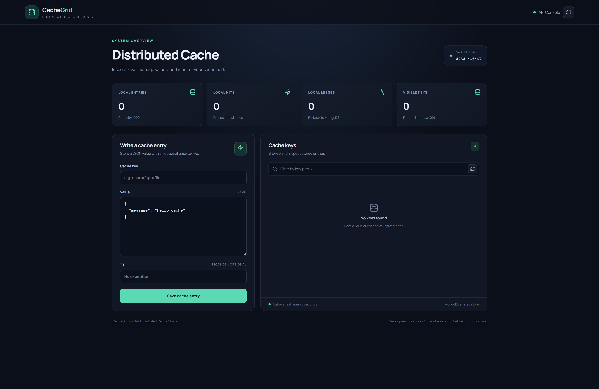

# Distributed Cache Service


A full-stack **Distributed Cache Service** built using the MERN stack. This project combines MongoDB-based shared storage with an in-memory LRU cache to provide fast data access across multiple backend instances.

## 📸 Screenshots



## ✨ Features

- REST API for creating, reading, updating, and deleting cache entries.
- MongoDB shared storage for cache data.
- In-memory LRU caching for faster repeated reads.
- Time-to-live (TTL) support for cache expiration.
- MongoDB change streams for cross-instance cache invalidation.
- React dashboard for managing cache entries.
- Key-prefix filtering and cache statistics.
- Docker Compose configuration for running all services.
- Basic unit tests for the local cache implementation.

## 🛠️ Technologies Used

| Technology | Purpose |
|---|---|
| MongoDB | Shared cache storage |
| Express.js | REST API |
| React.js | Frontend dashboard |
| Node.js | Backend runtime |
| Vite | Frontend development and build tool |
| Mongoose | MongoDB integration |
| Docker | Containerization |

## 🏗️ Architecture

```text
React Dashboard
      |
      | HTTP / JSON
      v
Express REST API
      |
      v
Local LRU Cache
      |
      | Cache miss / write
      v
MongoDB Shared Store
      |
      v
Change Streams
      |
      v
Invalidate Local Entries
Across API Instances
```

Each backend instance maintains its own local LRU cache, while MongoDB acts as the shared data store. Change streams help invalidate local entries when other instances modify the stored data.

## 🚀 Getting Started

### Prerequisites

- Docker Desktop
- Node.js and npm (for running without Docker)
- MongoDB 7 with replica-set support (for local backend development)

### Installation

Clone the repository:

```bash
git clone https://github.com/ajinkya029/distributed-cache.git
cd distributed-cache
```

### Run with Docker Compose

```bash
docker compose up --build
```

Access the application:

- **Frontend:** http://localhost:5173
- **Backend health:** http://localhost:4000/health
- **Cache statistics:** http://localhost:4000/api/stats

Stop the services with `Ctrl+C`, or use:

```bash
docker compose down
```

### Run the backend separately

```bash
cd server
cp .env.example .env
npm install
npm run dev
```

### Run the frontend separately

Open another terminal:

```bash
cd client
npm install
npm run dev
```

For local development, ensure MongoDB is running as a replica set because the cache invalidation mechanism uses change streams.

## 📡 API Endpoints

| Method | Endpoint | Description |
|---|---|---|
| GET | `/health` | Check API and database status |
| GET | `/api/stats` | Get local cache statistics |
| GET | `/api/cache` | List cache keys |
| GET | `/api/cache/:key` | Retrieve a cache value |
| PUT | `/api/cache/:key` | Create or update a cache value |
| DELETE | `/api/cache/:key` | Delete a cache entry |

### Example: Store a cache entry

```bash
curl -X PUT http://localhost:4000/api/cache/user:42 \
  -H "Content-Type: application/json" \
  -d '{"value":{"name":"Ada"},"ttlSeconds":300}'
```

### Example: Retrieve a cache entry

```bash
curl http://localhost:4000/api/cache/user:42
```

### Example: Delete a cache entry

```bash
curl -X DELETE http://localhost:4000/api/cache/user:42
```

## 🧪 Run Tests

```bash
cd server
npm install
npm test
```

## 📁 Project Structure

```text
distributed-cache/
├── client/
│   ├── src/
│   │   ├── App.jsx
│   │   ├── main.jsx
│   │   └── styles.css
│   ├── Dockerfile
│   └── package.json
├── server/
│   ├── src/
│   │   ├── cache/
│   │   ├── models/
│   │   ├── routes/
│   │   ├── config.js
│   │   └── index.js
│   ├── Dockerfile
│   ├── .env.example
│   └── package.json
├── docker-compose.yml
├── mongo-init.js
└── README.md
```

## 🔐 Security and Production Notes

This is a starter project intended for learning and development. Before production deployment:

- Add authentication and authorization.
- Configure rate limiting and request validation.
- Add monitoring, structured logging, and error tracking.
- Improve change-stream reconnection and cache consistency handling.
- Use a highly available MongoDB deployment.
- Configure secure environment variables and network access.

For workloads requiring high throughput and advanced distributed caching guarantees, consider evaluating Redis Cluster.

## 📄 License

No license is currently included. Add a license file before publishing the project publicly.

## 👨‍💻 Author

**Ajinkya Dhatrak**

GitHub: [ajinkya029](https://github.com/ajinkya029)

---

⭐ If you find this project useful, consider giving the repository a star!
